# 文件去标识化工具

[](#测试与质量)

[](LICENSE)

**在浏览器里完成、数据不出电脑的文件去标识化工具。** 上传 PDF（含扫描件，在浏览器内识别文字）／Word／Excel／TXT／Markdown 或直接粘贴文字，自动检测中文姓名、居民身份证号、手机、固定电话、地址、邮箱、单位名称、统一社会信用代码、银行卡号、车牌号、护照号与自定义标识符，以及国际电话、信用卡、美国 SSN、IBAN、IPv4／IPv6、出生日期等国际格式；按原始格式预览、人工复核后，下载去标识化文件与 CSV 编码对照表，以后可凭编码表完整还原；不需要还原时，也可以只输出 `[姓名]` 这类类别标记或「○」占位。

<p align="center">
  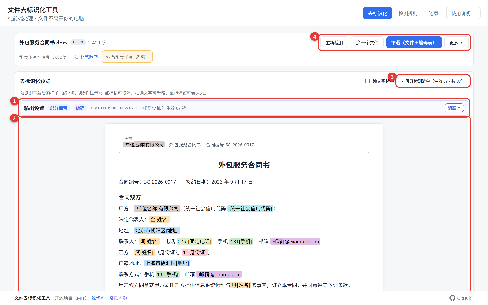
</p>

---

## 目录

- [为什么需要这个工具](#为什么需要这个工具)
- [功能特色](#功能特色)
- [隐私与安全设计](#隐私与安全设计)
- [快速开始](#快速开始)
- [操作流程](#操作流程)
  - [步骤 1：上传文件或粘贴文字](#步骤-1上传文件或粘贴文字)
  - [步骤 2：查看预览与输出设置](#步骤-2查看预览与输出设置)
  - [步骤 3：查看原文与实际编码](#步骤-3查看原文与实际编码)
  - [步骤 4：人工调整](#步骤-4人工调整取消误判整类取消新增漏抓)
  - [步骤 5：下载去标识化文件与编码表](#步骤-5下载去标识化文件与编码表)
  - [步骤 6：管理检测规则](#步骤-6管理检测规则)
  - [步骤 7：用编码表还原](#步骤-7用编码表还原)
- [支持格式与限制](#支持格式与限制)
- [检测规则](#检测规则)
- [输出格式：标记与编码表](#输出格式标记与编码表)
- [示例文件下载与体验](#示例文件下载与体验)
- [开发](#开发)
- [测试与质量](#测试与质量)
- [项目结构](#项目结构)
- [部署](#部署)
- [授权](#授权)
- [来源与致谢](#来源与致谢)

---

## 为什么需要这个工具

把合同、报价单、客户清单交给第三方（外包厂商、AI 服务、研究单位）之前，需要先移除个人信息；但一般做法要么把文件上传到不知名的网站，要么用替换功能手动涂改、事后无法还原。这个工具的取舍是：

| 需求 | 做法 |
|------|------|
| 数据不能外流 | 纯前端、可离线、可自行部署静态网站；没有任何后端 |
| 要能还原 | 每条敏感信息换成唯一编码，CSV 编码表是还原凭证；只需去标识化时可改用类别标记或「○」占位，不产生编码表 |
| 要保留文件格式 | Word／Excel 直接改写文字节点，样式表格不动；PDF 按原坐标重建；扫描 PDF 识别出文字后同样按原位置重建，并保留不含文字的图片 |
| 规则不可能完美 | 自动检测只是建议：预览、逐条或整批取消、框选新增，全部在同一个画面完成 |

## 功能特色

- **多格式输入**：`.pdf`（文字型或扫描影像）、`.docx`、`.xlsx`、`.txt`、`.md`，或直接粘贴文字；一次最多 10 个文件混合处理，单文件 100 MB 以内（超过时以警告弹窗拦截）。
- **纯文本编码兼容**：`.txt`／`.md` 自动识别 UTF-8 与 GB18030（含 GBK／GB2312），大陆常见的 GBK 编码文本不会乱码。
- **扫描件文字识别（OCR）**：没有文字层的 PDF 会在浏览器内以 Tesseract（简体中文＋英文）逐页识别，有专属的识别画面（页数、进度、当前页缩略图、可取消）。识别前后加上几道算法提高成功率：移除表格框线、加深彩色字（蓝笔手写、彩色名片）、版面分析漏掉的文字行另外补识别（字距加宽的大字如「通　知　函」「董　事　长」读不清时放大再读）、段落开头的条列编号（「一、」只有一横，单独读不出来）连同该行开头一起重读、身份证／手机／统一社会信用代码的字形校正（`I→1`、`O→0`、`g→9`，须通过校验位才采用）、低信心字词与中文行中被误读成英文的手写人名（「丁承」→「TR」）以纯中文模型放大重读；内置 5 页扫描示例实测字符召回 98.6%、精确 98.5%，印刷值 125/144、手写值 10/13。照片、标志等**不含文字的图片**会原样保留在输出中，可在预览逐张取消。
- **扫描件的版面还原**：表格框线（含虚线框）、单元格底色、文字颜色（如蓝笔手写）按原位置重绘；**复选框**（☐／☑，打勾、打叉或涂满）以方框＋勾号重绘并保留勾选状态，框旁的选项文字照常识别；整页**倾斜**或扫描时**放反**（90°／180°）会先自动转正再识别。这些结构都是重新绘制的纯色图形，不会带出原页面影像。文字大小按中文字的高度推算，行距密的版面（例如名片）上下行也不会互相重叠。
- **格式感知预览**：Word 显示段落／标题／表格／页眉页脚，Excel 显示工作表格线，PDF 逐页按原坐标排版；可切换纯文本查看。
- **所见即所得的预览**：预览就是下载后的样子，编码以类别名称表示（如 `[姓名]`、`11[身份证]`），鼠标悬停显示原文与实际输出标记。
- **人工复核**：点击标记确认取消、在「按类别调整」整类取消、框选文字手动新增、清单定位。
- **十七种内置类别**：
  - 中国大陆格式：姓名、居民身份证号（校验位）、手机、固定电话、地址、单位名称、统一社会信用代码（校验位）、银行卡号（Luhn）、车牌号、护照号；
  - 国际与通用格式：邮箱、国际电话（验证号码有效性）、信用卡（Luhn）、美国 SSN、IBAN（mod-97）、IPv4／IPv6、出生日期（按标签）；
  - 规则可停用，自定义规则以 RegExp 新增并即时测试。英文姓名与地址尚未支持，请在预览中框选新增。
- **可还原**：同一类别下完全相同的值共用同一个随机编码（手动新增亦同）；上传去标识化文件＋CSV 即可完整还原，缺漏的编码会列出警告。
- **输出方式可切换**：预览上方的「输出设置」可选 **部分保留**（默认，例如 `11[身份证:7b21e8]`，只露出适合统计的字符）、**全部隐藏** 或 **自定义**（逐类别调整保留多少并可设为默认），整批文件一起套用；预览就是下载后的样子。
- **部分保留（方便统计）**：可逐类别保留前／后几位、分隔字符前后、姓氏、省市或省市＋区县，例如 `11[身份证:a3f9c2]`、`[邮箱:c882d1]@example.com`、`北京市朝阳区[地址:4e1a0b]`；保留的字符留在标记外，Excel 可直接用 LEFT／RIGHT 分组，仍可完整还原。设置时会即时预览，保留过多时会在该行警告。
- **标记方式（是否需要还原）**：默认 **编码** `[姓名:6e679d]`，附编码表可还原；只要去标识化、不打算还原时，可改选 **类别** `[姓名]` 或 **空白占位** `○○○`（像公文一样以「○」取代每个字，分隔符号保留，例如 `138-○○○○-○○○○`），下载就只有去标识化文件，界面与状态栏会标示「无法还原」。可与部分保留／全部隐藏／自定义并用，例如部分保留＋空白占位是 `王○○`。
- **跨文件共用编码**：可随时切换「整批共用编码」，或导入上次的编码表沿用旧编码（例如每月数据串接），并可下载合并编码表。
- **打包输出**：多文件时一键打包 ZIP（每个文件的去标识化文件＋编码表＋对照清单）。

## 隐私与安全设计

- **所有处理都在浏览器内完成**。文件内容、敏感值与编码表不会经由网络传送到任何服务器；加载页面后即使离线也能使用。
- 浏览器只会保存「检测规则设置」（localStorage）；文件内容与编码表不落地。
- 文字识别的程序与模型（约 9 MB）跟网站一起部署、由同一个网站提供，不连任何 CDN；只在第一次遇到扫描件时下载，之后由浏览器的 HTTP 缓存重用，不写入浏览器存储空间。
- 编码是 `crypto.getRandomValues` 产生的 6 位十六进制随机码，与原文无数学关联，无法由编码反推原始值。
- **输出文件内不残留原始敏感文字**：
  - PDF 采「文字重建」而非白框覆盖（覆盖法的底层文字仍可被复制出来）；扫描 PDF 只带出识别后的文字与经确认不含文字的图片，其余页面影像一律不复制；
  - Excel 会清空不再被任何单元格引用的共享字符串（`sharedStrings.xml`）；
  - Word 直接改写文字节点，跨 run 拆散的值也会整段替换。
- 尚未下载结果就关闭或重新加载页面时会提醒。
- **编码表 (`*.mapping.csv`) 是还原的唯一凭证，本身即为敏感文件，请妥善保管。**

## 快速开始

**本机运行**：把仓库 clone 到本地后，在根目录执行

```bash
npm install
npm run dev        # http://localhost:5173
```

**自行部署**：`npm run build` 生成的 `dist/` 是纯静态站点，放到任何静态空间（Cloudflare Pages、GitHub Pages、S3、Nginx、内网文件服务器）即可；也可直接以文件方式打开 `dist/index.html`。

站点地址不写死在源码里，需要在构建时用环境变量传入：

```bash
SITE_URL=https://your-domain.example npm run build
```

设置后 canonical、`og:url`、JSON-LD 的 `@id` 与 `sitemap.xml` 都会填成绝对地址。不设置也能正常使用，页面改用相对引用，只是不生成 `sitemap.xml`、`robots.txt` 里也没有 `Sitemap` 行。

## 操作流程

以下截图由 `npm run screenshots` 自动生成（`docs/screenshots/`），红框编号对应说明。示例文件皆为虚构数据。

### 步骤 1：上传文件或粘贴文字

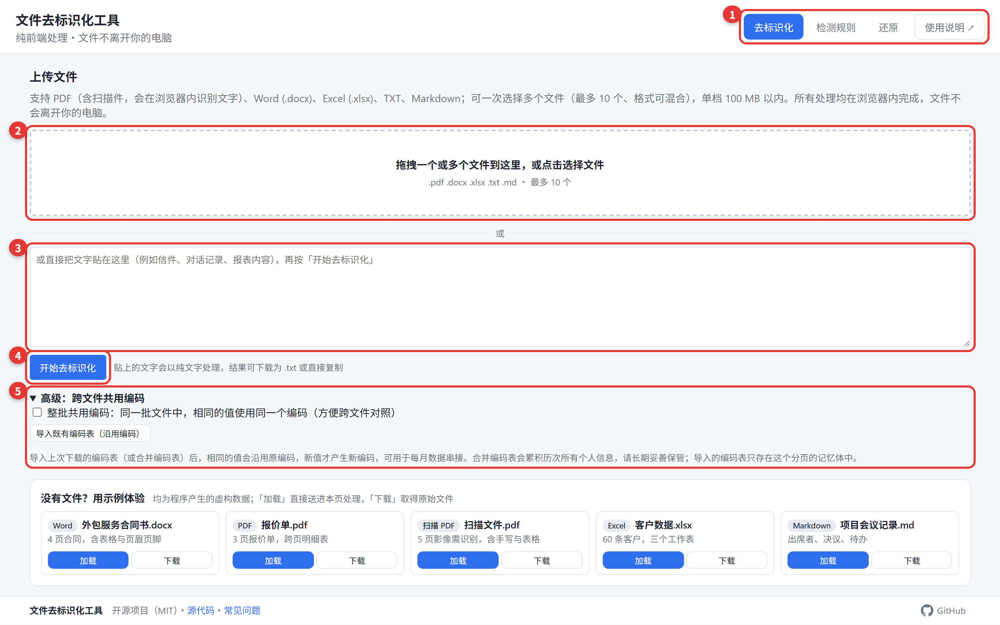

1. 三个标签页：**去标识化**（主要流程）、**检测规则**（管理规则）、**还原**（用编码表恢复）。
2. 把文件拖进虚线区或点击选择。支持 `.pdf`（含扫描件）、`.docx`、`.xlsx`、`.txt`、`.md`，单文件 100 MB 以内；选到超过上限的文件会弹出警告弹窗列出文件名，按「我知道了」后其余文件照常处理。
3. 或直接把文字（邮件、对话记录、报表内容）粘贴在文字框，
4. 按「开始去标识化」（或 Ctrl/⌘+Enter）。粘贴的文字按纯文本处理，结果可下载为 `.txt`，也可用「更多 → 复制去标识化文字」一键复制。
5. **高级：跨文件共用编码**（选用，处理中也可以在「输出设置」的「高级：编码范围」切换）：勾选「整批共用编码」后，同一批文件中相同的值会使用同一个编码；按「导入既有编码表」可沿用上次的编码（新值才生成新编码），适合每月数据串接。合并编码表会累积历次所有个人信息，请妥善保管。

可以一次选择多个文件（格式可混合，**最多 10 个**）：

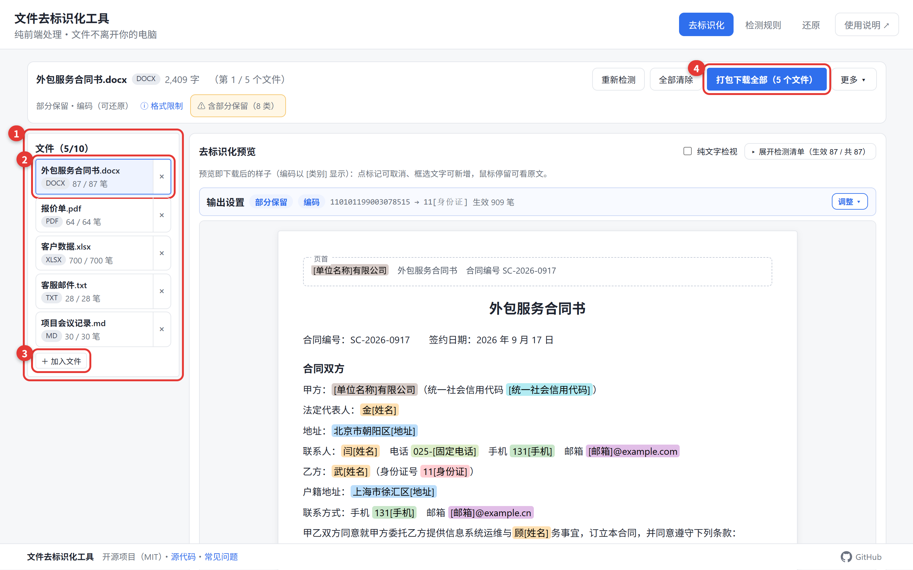

1. 左侧文件面板列出所有文件、格式与检测条数，
2. 点击即切换预览与编辑的文件（每个文件各自有独立的检测结果与编码表），
3. 「＋ 加入文件」可再补文件（含粘贴的文字），× 可移除，
4. 「打包下载全部」把每个文件的去标识化文件与编码表连同 `清单.csv`（对照表）打包成一个 ZIP。

### 步骤 2：查看预览与输出设置


1. **输出设置**：平常收合成一行摘要（保留与标记方式、示例与生效条数），按右侧的「调整 ▾」展开（见下方）；展开后按钮变成蓝底的「收起 ▴」，检测清单的展开按钮也一样。
2. **预览区**：按文件格式呈现，Word 显示段落、标题、表格与页眉页脚（如上图的 4 页合同书）。**预览就是下载后的样子**，只是编码以类别名称表示：部分保留（默认）时是 `王[姓名]`、`11[身份证]`，全部隐藏时是 `[姓名]`。
3. **展开检测清单**：清单默认收起；展开后列出每一条的类别、原文与输出，点击任一条会滚动到预览中的位置并闪烁强调。
4. **重新检测**（规则变更后重跑，手动新增的项目会保留）／**换一个文件**／**下载**／**更多**都在上方工具栏。

展开「输出设置」可以决定下载文件中每条数据要露出多少、隐藏的部分写成什么，整批文件一起套用：

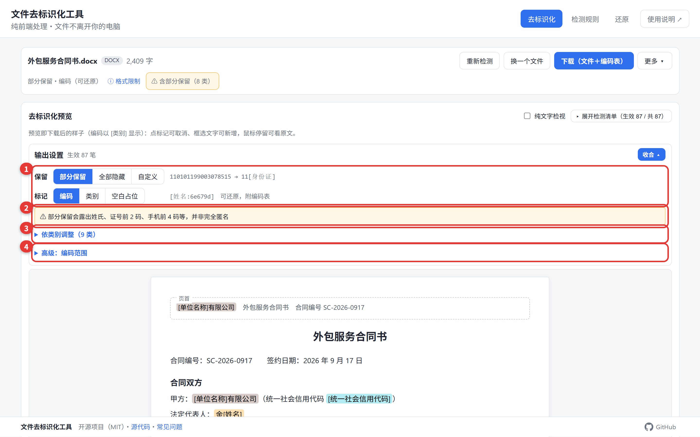

1. 两列选择，右侧即时显示示例。**保留**：**部分保留**（默认，`110101199003078515 → 11[身份证]`）／**全部隐藏**（`[身份证]`）／**自定义**（逐类别设置）；**标记**：**编码**（默认，可还原）／**类别**／**空白占位**（见下方）。部分保留只露出适合统计、较难反查个人的部分：姓氏、身份证前 2 位（省级行政区）、手机前 3 位（号段）、固定电话区号、省市＋区县、Email 域名、单位组织形式（如「有限责任公司」）、车牌省份简称、银行卡后 4 位、出生年份；统一社会信用代码、SSN 与护照号全部隐藏。
2. 需要注意的事合并成一行提醒，例如部分保留并非完全匿名；交给外部前请确认，或改选「全部隐藏」。
3. **按类别调整**（平常收起）：每个类别一行，显示条数、套用的保留方式与示例输出。取消勾选即整类不去标识化（套用到所有文件）。
4. **高级：编码范围**（只在标记为「编码」时出现）：整批共用编码、导入既有编码表，见下方说明。

选 **自定义** 时，「按类别调整」会自动展开，可以逐类别调整保留多少：

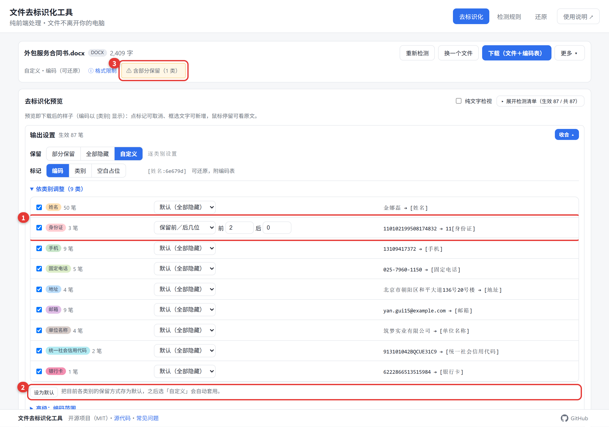

1. 例如把身份证改为「保留前 2 位」，右侧即时显示 `110101199003078515 → 11[身份证]`，下载后可在 Excel 用 `LEFT(单元格,2)` 统计省级地区。可选全部隐藏、保留前／后几位、以分隔字符为界（例如 Email 保留 `@` 之后）、保留姓氏、保留到省或省＋市、部分保留（标准）；有错误或风险时直接在该行提示。
2. **设为默认**：把当前各类别的保留方式存在浏览器，之后选「自定义」会自动套用（「检测规则」页按「查看规则」可看到各规则的默认保留）。
3. 只要有部分保留，工具栏的状态栏会以警示色显示「⚠ 含部分保留（N 类）」，鼠标悬停可看是哪些类别。

**标记** 那一列决定隐藏的部分写成什么、以后能不能还原：

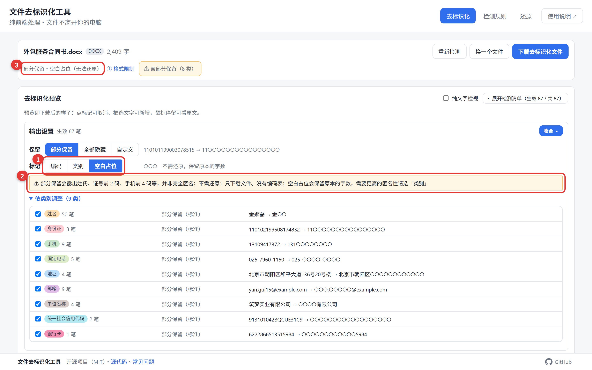

1. 三选一：**编码** `[姓名:6e679d]`（默认，可还原，下载附编码表）／**类别** `[姓名]`（不需还原）／**空白占位** `○○○`（不需还原，每个字或数字换成「○」，分隔符号保留）。
2. 选了不需还原的方式时，提醒会加上：下载只有去标识化文件、没有编码表，以后无法还原；「空白占位」会保留原本的字数（例如看得出姓名是两字或三字），需要更高的匿名性请选「类别」。
3. 状态栏同步显示当前的设置，例如「部分保留・空白占位（无法还原）」。

选好之后，预览与下载都跟着改变：

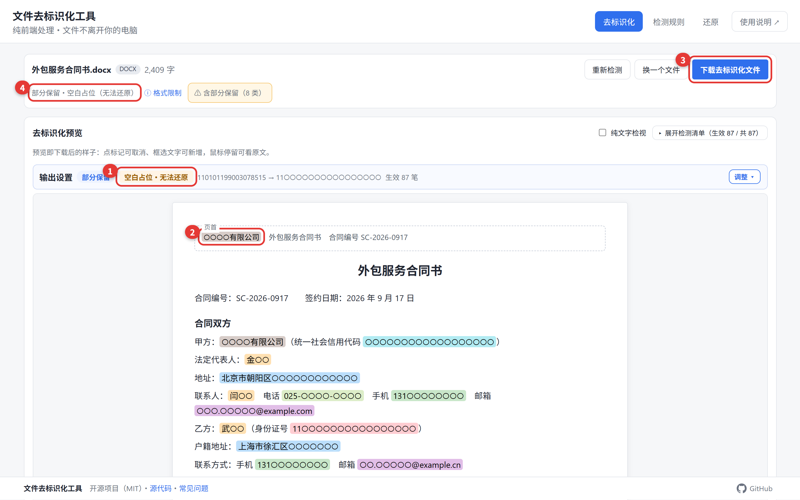

1. 输出设置的摘要标示「空白占位・无法还原」；
2. 预览直接显示输出内容，例如 `○○○○有限责任公司`、`范○○`、`138-○○○○-○○○○`（鼠标悬停仍可看原文）；
3. 下载按钮变成「下载去标识化文件」，只下载文件；多文件时打包的 ZIP 也只有文件与清单；
4. 状态栏注明「无法还原」，「高级：编码范围」、只下载编码表等与还原有关的选项都会隐藏。改回「编码」就恢复原本的设置。

怎么选：以后要把结果对回原始数据（例如外包处理后再还原、每月数据串接）用 **编码**；只是交给外部阅读或给 AI 摘要用 **类别**；要保留版面与字数感、像公文遮蔽用 **空白占位**。

使用编码时，**高级：编码范围** 可以随时切换整批共用编码或导入编码表，切换后所有文件的编码会重新分配。切换保留方式同样会让保留字符改变的项目换成新编码（每个编码只对应一种被隐藏的片段，才能正确还原），所以请用「下载（文件＋编码表）」一次获取成对的文件。

Excel 以工作表格线呈现，可切换工作表（下图 1、2），右上角可切换「纯文本查看」与检测清单（3）：

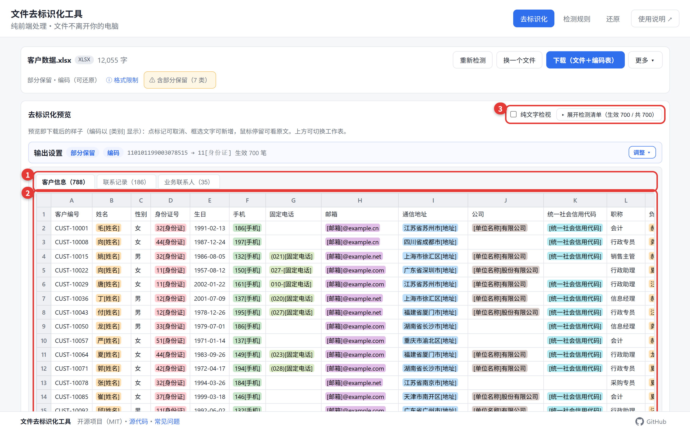

PDF 按原坐标逐页排版（下图 1 页码、2 页面），表格与版面与原文件一致：

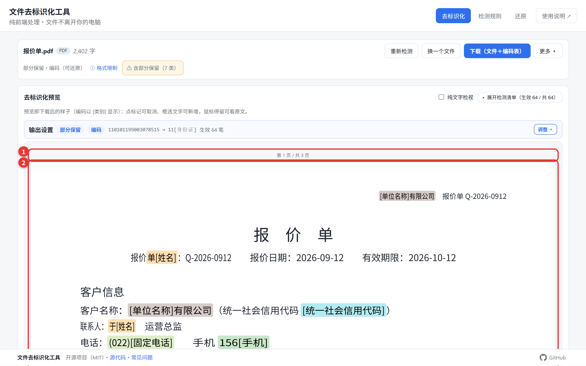

**扫描件（图片型 PDF）**：没有文字层的 PDF 会自动改用文字识别，出现专属的识别画面：

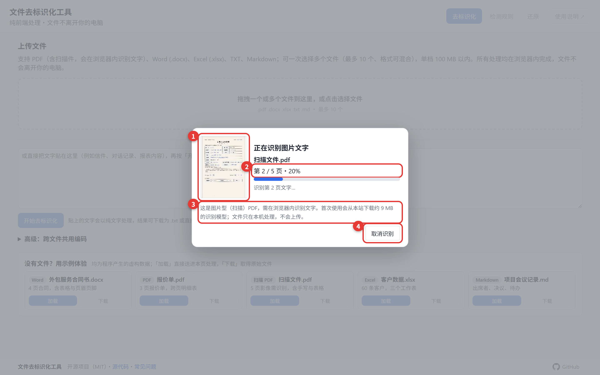

1. 当前识别的页面缩略图（扫描线动画）；
2. 第几页／共几页与整体进度，下方显示当前步骤（判断方向并转正、识别文字、分析表格与复选框）；
3. 说明：首次使用会从本站下载约 9 MB 的识别模型，文件只在本机处理；
4. 随时可以「取消识别」，该文件不会加入，同批的其他文件照常加载。

识别完成后与一般 PDF 相同：自动检测、预览、取消、框选新增都一样。


1. 格式旁标示「文字识别」；
2. 「ⓘ 格式限制」说明识别可能有误，请逐页核对、手动补上漏抓的项目；
3. 照片、标志等**不含文字的图片**以绿色虚线框标出，会以原影像保留在下载文件中；含文字的区域（印章、手写、表格）不会保留影像。点图片左上角的「✓ 保留」可逐张取消（例如照片中有人脸或证件），取消后下载文件就不含该图。

表单、表格类的扫描页会一并还原版面结构，预览与下载文件相同：

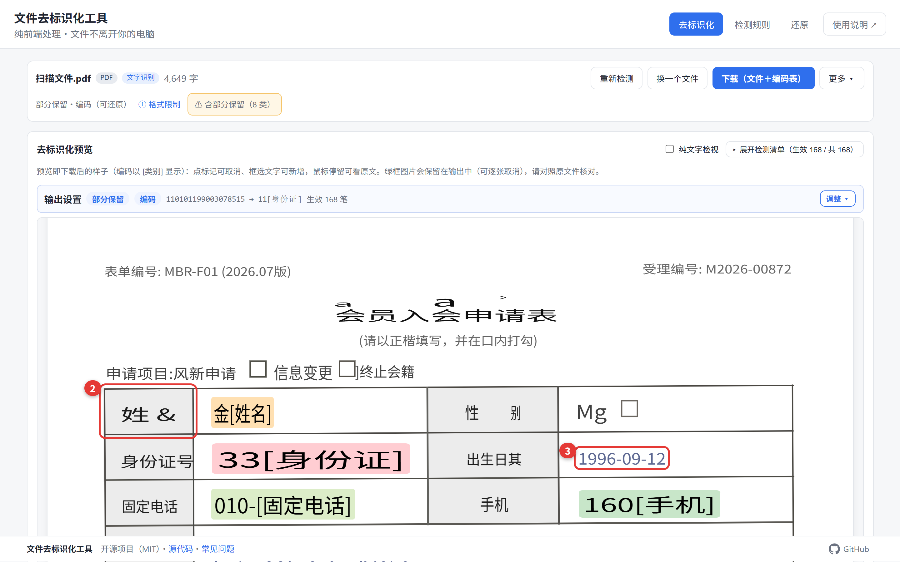

1. 复选框以方框＋勾号重绘，保留勾选状态；方框旁的选项文字（男、女）照常识别，不会变成「口」「[」「了」之类的杂字；
2. 表格框线与单元格底色按原位置、粗细与颜色重绘；
3. 文字沿用原稿的颜色，例如蓝笔手写。

整页倾斜或扫描时放反（90°／180°）会先自动转正再识别；不到 1° 的轻微倾斜照原样识别（转正反而会让识别变差），但线条、底色、复选框仍完整还原。

还原只还原文字：还原后的文件是文字版面重建，不含保留的图片、线条与复选框。

### 步骤 3：查看原文与实际编码


1. 鼠标移到任何标记上，tooltip 显示「类别｜原文｜输出标记」，输出标记就是下载文件中的样子，例如 `[姓名:a3f9c2]`。

### 步骤 4：人工调整（取消误判、整类取消、新增漏抓）

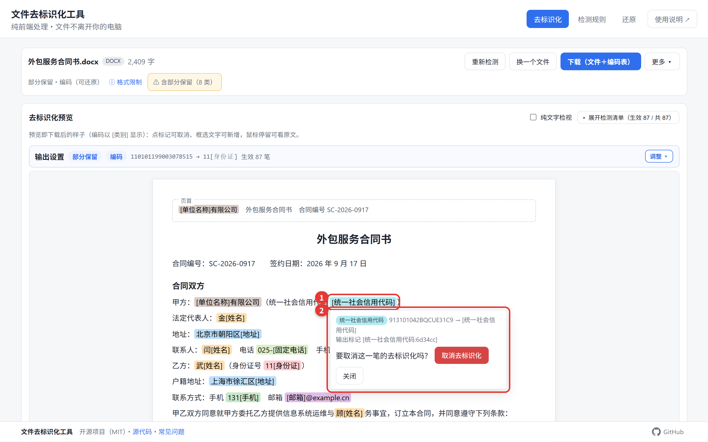

1. 点击预览中任何一个已去标识化的标记，
2. 会弹出确认弹窗显示类别、原文与输出标记；按「取消去标识化」即恢复原文（已取消的项目再点一次可「加回」）。

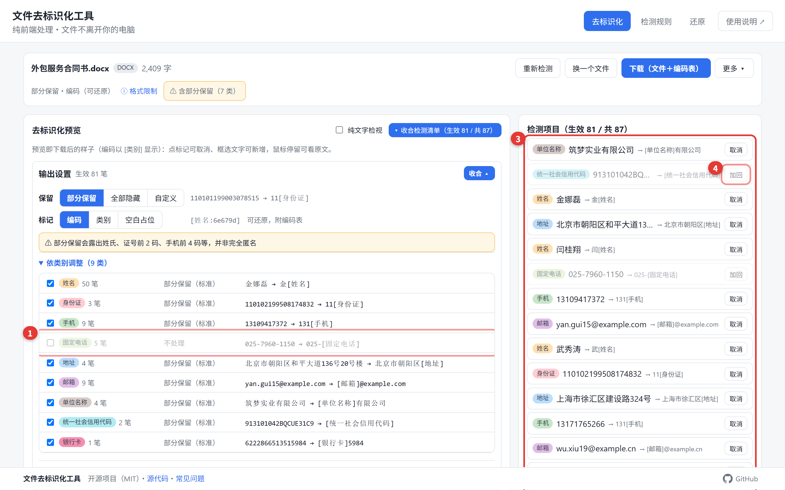

1. 在「输出设置」的「按类别调整」取消勾选某类别（例如「固定电话」），该类别全部取消；再勾选即恢复。
2. 被取消的项目在预览中恢复原文并以红色虚线标示。
3. 展开检测清单可逐条查看，
4. 清单中的 **取消／加回** 按钮同样可切换单条。

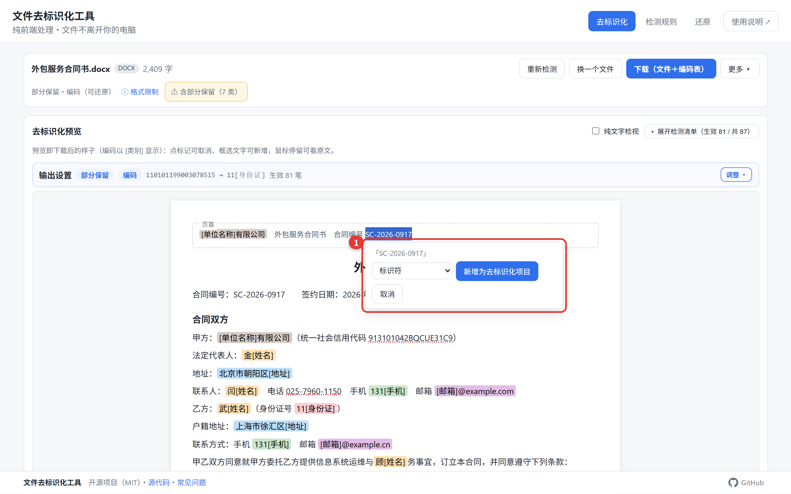

1. 在预览中用鼠标框选任何文字，会弹出浮动窗口：选择类别后按「新增为去标识化项目」，该段文字即被加入（若与既有项目重叠会提示）。手动新增的项目和同类别的其他项目套用相同的保留方式。

### 步骤 5：下载去标识化文件与编码表

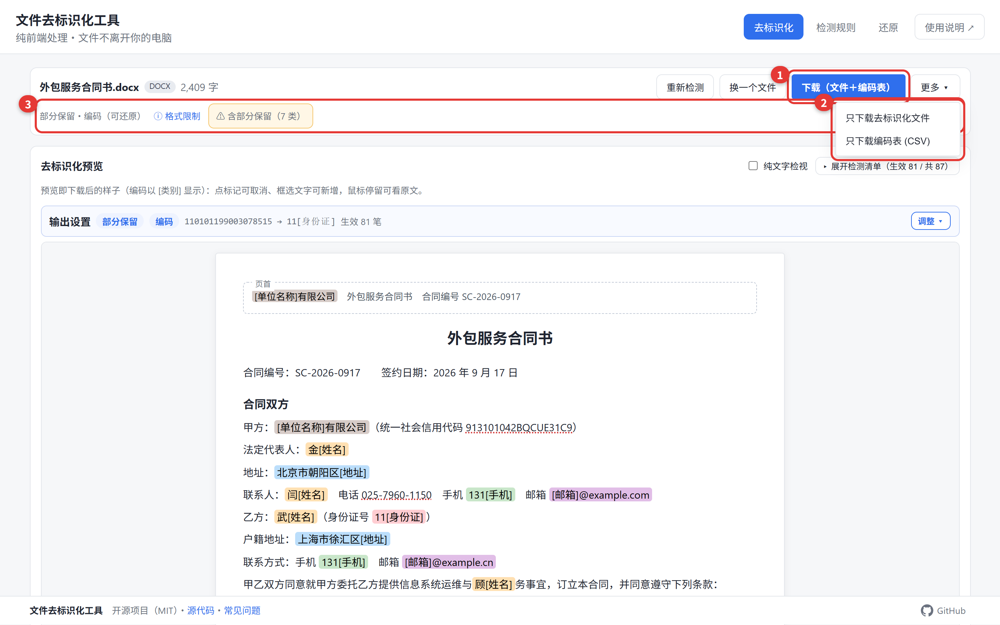

1. **下载（文件＋编码表）** 一次下载去标识化文件（格式与上传相同，文件名加 `.deid`）与编码表（`*.mapping.csv`），确保两者成对。多个文件时主要按钮是「打包下载全部」。浏览器第一次可能会询问是否允许下载多个文件。
2. **更多**：只下载文件、只下载编码表、复制去标识化文字（TXT／Markdown）、下载合并编码表（开启共用编码或导入编码表时）。若单独下载的文件和先前下载的另一份不是同一个版本，会提醒你重新下载。
3. **状态栏**：一行显示当前的保留与标记方式（是否可还原、是否整批共用编码），有部分保留时以警示色提示；鼠标停在「ⓘ 格式限制」可看 PDF／Excel／Word 的限制，停在下载按钮上可看「编码表是还原的唯一凭证」的提醒。尚未下载就关闭或重新加载页面时会弹出提醒。

### 步骤 6：管理检测规则

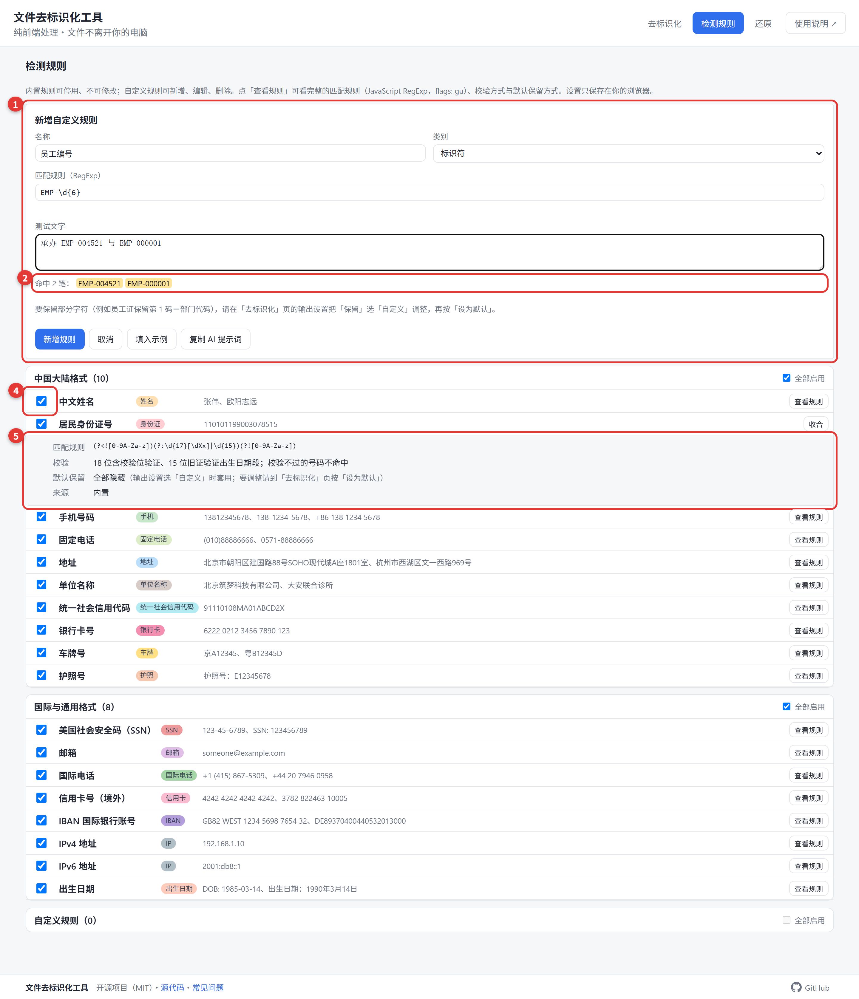

1. 按右上角的 **＋ 新增自定义规则** 打开表单：名称、类别、匹配规则（JavaScript RegExp）；无效的规则会即时显示错误并拒绝保存，按「取消」收起。不知道规则怎么写？按 **填入示例** 会用默认的「员工编号」规则填满表单；鼠标停在 **复制 AI 提示词** 上可预览提示词，点一下即复制，贴给 ChatGPT／Claude／Gemini 就能拿到可直接贴回的规则。
2. 在「测试文字」粘贴样本即时看到命中结果。设置只存在你的浏览器，重新加载后仍保留。
3. 规则按 **中国大陆格式／国际与通用格式／自定义规则** 分组，点标题可收起；右侧「全部启用」可整组启用或停用。
4. 每条规则一行：开关、名称、类别、示例。复选框可单独启用／停用（内置规则不可修改或删除）。
5. **查看规则** 展开完整的匹配规则、校验方式（例如身份证校验位）、在「自定义」下的默认保留方式与来源；默认保留为只读，要修改请到去标识化页的「输出设置」调整后按「设为默认」。自定义规则在这里编辑或删除。

### 步骤 7：用编码表还原

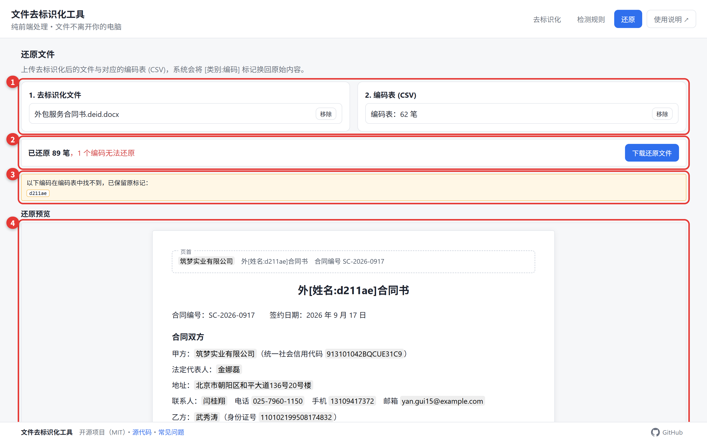

1. 上传去标识化文件与对应的 CSV 编码表（顺序不拘，两者齐全即自动还原）。
2. 显示已还原条数；点「下载还原文件」获取同格式的还原文件（文件名加 `.restored`）。
3. 若文件中有编码在 CSV 找不到，会列出无法还原的编码并保留原标记；若文件里完全没有编码（以「类别」或「空白占位」输出的文件），会提示这类文件无法还原。
4. 还原预览：被换回的原文以绿色标示。

## 支持格式与限制

| 格式 | 输入 | 输出 | 限制 |
|------|------|------|------|
| TXT / Markdown / 粘贴文字 | ✅ | 同格式 | 自动识别 UTF-8 与 GB18030 |
| Word | 仅 `.docx` | `.docx`，样式／表格／页眉页脚完整保留 | 不支持旧版 `.doc`；文本框、批注可能未涵盖 |
| Excel | 仅 `.xlsx` | `.xlsx`，单元格样式与工作表结构保留；被替换的单元格改为 inline string，未再引用的共享字符串会清空 | 仅处理文字型单元格：以数值保存的电话／证号、公式结果、工作表名称、批注不在范围 |
| PDF | 含文字层 | `.pdf`，文字按原坐标重建，内嵌 Noto Sans SC 子集 | 图片、图形、原字体不保留 |
| 扫描 PDF | 整份没有文字层（扫描、拍照转档） | `.pdf`，识别出的文字按原位置与颜色重建，表格框线、底色与复选框重绘，保留不含文字的图片 | 识别可能误认或遗漏（手写、模糊时更明显；倾斜 10° 以内与 90°／180° 转向会自动转正），请逐页核对；部分页面才有文字层的混合型 PDF 只处理文字层；还原页不识别扫描件 |

其他：单文件上限 100 MB（全部在浏览器内存内处理，过大的文件在手机上可能失败）、单次最多 10 个文件；还原一次处理一份；规则以中国大陆格式为主。中文姓名与地址无法以规则做到零误判／零漏抓，请务必在预览中人工复核。

## 检测规则

| 类别 | 内置规则 | 精确度设计 |
|------|----------|------------|
| 姓名 | 简体常见姓氏（含复姓）＋ 1–2 字名 | 名字必须落在文本边界，或两字以上称谓／谓语（先生、经理、表示、负责）之前；两字名只认这类强证据，三字名才接受「于／在／的」等单个虚词；「名」里出现名词后缀字（人、产、部、属、内…）直接否决；停用词表（房屋、项目、管道、权属、成果…）；「甲方／乙方／双方」的「方」不视为姓氏 |
| 身份证 | `\d{17}[\dXx]`、`\d{15}` | GB 11643 加权 11 校验位，且出生日期段须合法；15 位旧证只验日期 |
| 手机 | `1[3-9]\d{9}`、`138-1234-5678`、`+86 138 1234 5678` | 前后不得紧邻数字；支持空格／连字符分组 |
| 固定电话 | `010-88886666`、`(021) 6543 2100`、`+86 10 8888 6666` | 区号位数与本地号位数须匹配；无分隔写法要求精确位数 |
| 地址 | 省／市／区县＋乡镇街道＋路街巷＋门牌 | 省级行政区名为锚点，末尾必须是门牌号或村名；没写省市的短地址靠「区县＋路街＋门牌」兜底 |
| 邮箱 | 标准格式 | — |
| 单位名称 | 以「有限责任公司、股份有限公司、集团有限公司、分公司、支行、事务所、合作社、研究院、医院、学校…」结尾 | 排除「本公司／贵公司／该公司／子公司」与前置虚词 |
| 统一社会信用代码 | 18 位，字符集 `0-9A-HJ-NPQRTUWXY` | GB 32100 加权模 31 校验位 |
| 银行卡 | 16–19 位，可含空格／连字符 | Luhn ＋ 银联（62）等 BIN 号段 |
| 车牌 | 省简称＋字母（不含 I／O）＋5–6 位 | 省简称与字母位校验 |
| 护照 | `E/G/D/S/P`＋8 位 | 必须标签锚定（护照号／Passport No），否则不命中 |
| 国际电话 | `+` 加国码的各国号码，或北美 `(415) 867-5309`、`415-867-5309` | 以 [libphonenumber-js](https://gitlab.com/catamphetamine/libphonenumber-js)（Google 电话号码规则数据）验证号码有效性；+86 号码归手机／固定电话；号码后面紧接其他数字时只取有效的部分。部分保留露出国码（北美为区码） |
| 信用卡 | 13–19 位，可用空白或连字符分组 | Luhn ＋ 发卡机构号段（Visa、Mastercard、AmEx、Discover、JCB、UnionPay、Diners）＋常见分组格式。部分保留露出末 4 位 |
| SSN | `123-45-6789`、`123 45 6789`，或「SSN:」后的 9 位数 | 排除 000、666、9xx 区码与 00 组码、0000 序号。全部隐藏 |
| IBAN | `GB82 WEST 1234 5698 7654 32`、`DE89370400440532013000` | mod-97 ＋ 各国固定长度。部分保留露出国别码 |
| IP | IPv4、IPv6 | IPv4 各段 0–255，排除版本号；IPv6 以浏览器内置的网址解析验证，排除时间与 MAC 地址。部分保留露出前两段 |
| 出生日期 | DOB、Date of Birth、Birthday、Born、出生日期、生日等标签后的日期 | 标签与日期在同一行（或表格的下一格）；支持 `YYYY-MM-DD`、`YYYY.MM.DD`、`YYYY年M月D日`、`YYYYMMDD` 等写法；没有标签的日期不检测。部分保留露出年份 |

命中重叠时较长者优先。所有规则都在「检测规则」标签页公开可查看、可停用。网址、英文姓名与地址目前没有内置规则（没有可靠的格式或需要语言模型），可自定义规则或在预览中框选新增；自定义规则可用来处理员工编号、病历号等内部标识符（例如 `EMP-\d{6}`、`MRN-\d{4}-\d{5}`）。

## 输出格式：标记与编码表

- 文件中每条敏感信息以 `[类别:编码]` 替换，例如 `[姓名:a3f9c2]`；编码为 6 位小写十六进制。标记方式选「类别」时写成 `[姓名]`、选「空白占位」时写成 `○○○`，这两种不产生编码表、无法还原。
- **同一类别下完全相同的值共用同一个编码**：`王小明` 在文件中出现三次，会全部变成同一个 `[姓名:a3f9c2]`，编码表只列一行。自动检测与手动新增走同一套规则，框选新增的文字若与既有项目的类别、内容完全相同，就沿用既有编码。
- 值有任何差异（大小写、空白、标点）或类别不同，就是不同编码；编码以单一文件为范围，不同文件之间不共用。
- 编码表为 UTF-8（含 BOM）、RFC 4180 的 CSV，Excel 可直接打开：

  ```csv
  code,category,original
  a3f9c2,姓名,王小明
  7b21e8,身份证,110101199003078515
  c882d1,地址,"北京市朝阳区建国路88号, 8层"
  ```

- 采部分保留时，`original` 只记录被隐藏的片段，并在末尾加上 `kept_prefix`、`kept_suffix` 两列（全部隐藏时不输出这两列，格式与旧版相同）；编码以「类别＋完整原值＋保留切分」判断是否共用。
- 还原时以 `code` 查表；文件中查无的编码保留原标记并列出警告。格式合同见 `specs/001-doc-deidentify/contracts/`。

## 示例文件下载与体验

想先试试看？直接下载下面的示例（全部为程序生成的**虚构数据**，姓名、公司、地址、电话、证号均非真人），或在网页的「没有文件？用示例体验」区块按「加载体验」一键送进处理：

| 示例 | 格式 | 内容 | 下载 |
|------|------|------|------|
| 外包服务合同书 | Word | 4 页合同：合同当事人、十二条条款、附件表格、签署栏（含页眉页脚） | [contract.docx](public/samples/contract.docx) |
| 外包服务合同书 | PDF | 同一份合同的 PDF 版本 | [contract.pdf](public/samples/contract.pdf) |
| 报价单 | Word | 3 页报价单：客户数据、20 项明细（跨页表格）、联系窗口、签回栏 | [quotation.docx](public/samples/quotation.docx) |
| 报价单 | PDF | 同一份报价单的 PDF 版本 | [quotation.pdf](public/samples/quotation.pdf) |
| 客户数据 | Excel | 60 条客户＋联系记录 30 条＋业务窗口，三个工作表 | [customers.xlsx](public/samples/customers.xlsx) |
| 客服邮件 | TXT | 客服回复信与引用的原始来信 | [support-email.txt](public/samples/support-email.txt) |
| 项目会议记录 | Markdown | 出席者、决议表格、待办清单 | [meeting-notes.md](public/samples/meeting-notes.md) |
| 扫描文件 | 扫描 PDF | 5 页纯影像（需识别）：中文信函（含手写批注与机房照片）、蓝笔手写的会员申请表、横式名册表格、英文 Invoice（品项金额表、产品照片）、中英双语名片；模拟扫描的灰阶／彩色、轻微倾斜与纸张底色 | [scanned.pdf](public/samples/scanned.pdf) |
| 还原体验 | Word + CSV | 已去标识化的合同书与其编码表（在「还原」标签页加载） | [contract.deid.docx](public/samples/contract.deid.docx)、[contract.mapping.csv](public/samples/contract.mapping.csv) |

更多情境（人工调整、错误 CSV、自定义规则、格式边界）的示例在 `examples/`，说明见 [examples/README.md](examples/README.md)；`npm run examples` 可重新生成全部示例。

## 开发

需求：Node.js 20+（建议 22）。

```bash
npm install
npm run dev          # 开发服务器 http://localhost:5173
npm test             # Vitest：单元 + round-trip 集成测试
npm run build        # 类型检查 + 生成 dist/
npm run preview      # 试跑 dist/（http://localhost:4173）
npm run fixtures     # 重新生成 tests/fixtures 的 docx/xlsx/pdf
npm run examples     # 重新生成 examples/（含扫描示例、角度样本 tests/fixtures/scan-angles.pdf 与两者的原稿；需本机 Chrome）
npm run screenshots  # 重新生成 docs/screenshots/（需先 build + preview；使用本机 Chrome）
npm run eval:ocr     # 以原稿为答案，评分网站实际的扫描件识别（需先 build + preview；加 -- --verbose 列出漏抓与误判，-- --sample main|angles 只跑其中一份）
npm run og           # 重新生成 public/og.png（社交分享图，使用本机 Chrome）
```

本项目以 [spec-kit](https://github.com/github/spec-kit) 的规格驱动流程开发：`specs/001-doc-deidentify/`（之后的功能在 `specs/002-…`～`specs/009-zh-cn-rules/`）内有规格（spec）、研究决策（research）、实现计划（plan）、数据模型、合同与任务清单；`.specify/memory/constitution.md` 是项目宪章（纯前端零外传、可还原、人工复核必经、规则透明）。

## 测试与质量

- **387 个自动化测试**（32 个文件）：每条内置规则的命中／不命中样本、身份证与统一社会信用代码校验位、编码唯一性、CSV round-trip、检测重叠裁决与人工增删、规则设置持久化、脱敏格式、预览渲染、TXT／DOCX／XLSX／PDF 的「去标识化 → 还原」逐字符 round-trip、真实案例（多页合同书／报价单、60 条客户数据）的检测完整性（身份证／Email／手机 100%）、批量打包；扫描示例以真实 Tesseract 识别后的检测命中率（≥ 90%）、文字重建不重叠、保留图片与还原，以及框线移除、字形校正、图片检测、漏字补识别、线条／底色／复选框检测、倾斜与方向判断等识别算法的单元测试；结构重绘的输出也验证不含点阵影像、文字还原不变；三种标记方式在各格式的输出都验证过，不需还原的输出不含任何编码与被隐藏的内容、打包时不含编码表；国际格式（电话、信用卡、SSN、IBAN、IP、生日）的校验与英文示例零误判；输出设置与检测规则页的分组、收起与整组启停。
- **扫描件识别评分**：扫描示例由 HTML 生成，生成时一并输出「原稿」（各页实际文字、应检测的印刷／手写值、应保留的图片位置，以及表格线段、底色与复选框）；另有信函与表单以 3°、6° 倾斜及 90°、180° 转向产生的角度样本。`npm run eval:ocr` 在真实浏览器里跑网站，逐页回报字符召回／精确率（不计顺序、全半角视为相同）、个人信息命中、读错但仍遮蔽、误判、图片保留、线段召回／精确、底色命中、复选框（位置与勾选状态）与文字段重叠数。当前简体中文模型（`chi_sim`）的主示例基线：字符召回 98.6%／精确 98.5%，印刷值 125/144、手写值 10/13、误判 21，图片 4/4、线段 66/66、底色 18/18、复选框 6/6、文字重叠 0；角度样本（3°／6°／90°／180°）字符召回 97.2%～97.6%。
- **输出零残留**的回归测试：Excel 共享字符串、PDF 原始字节、Word 各 part 皆确认不含任何原始敏感值。
- 端对端验证记录：`specs/001-doc-deidentify/checklists/e2e-validation.md`。
- CI：每次 push 到 `main` 跑测试与构建，通过后自动部署 GitHub Pages。

## 项目结构

```text
src/
├── core/        检测规则、检测引擎、编码、CSV、脱敏、还原、规则设置
├── core/rules/  中国大陆行政区划（省／市）等纯数据
├── formats/     txt/md、docx、xlsx、pdf 解析与生成、TTF 稀疏子集、批量打包
└── ui/          三个标签页、格式感知预览、共用组件
tests/           unit / integration / fixtures / helpers
examples/        各情境示例文件（虚构数据）
scripts/         示例生成器（文件模型 → docx/pdf、HTML → 模拟扫描 PDF）、截图脚本
scripts/assets/scan/  扫描示例用的图片原档（以 Codex 生成，不含文字与人物）
specs/           spec-kit 规格、计划、任务、合同、验证记录
public/fonts/    Noto Sans SC（PDF 输出用）
```

技术：TypeScript + Vite（无 UI 框架）、`pdfjs-dist`（PDF 文字提取与扫描页渲染）、`tesseract.js`（浏览器内 OCR，模型 `@tesseract.js-data/chi_sim`、`eng`）、`pdf-lib` + `@pdf-lib/fontkit`（PDF 输出）、`jszip`（.docx / .xlsx / ZIP）、Vitest；截图脚本使用 `puppeteer-core` 驱动本机 Chrome。

## 部署

`.github/workflows/ci.yml`：push 到 `main` 或发起 PR 时跑 `npm ci` → `npm test` → `npm run build`，并把 `dist/` 作为构建产物留存。仓库本身不负责部署——`dist/` 是纯静态站点，托管在哪里都可以。

站点地址由构建时的 `SITE_URL` 环境变量注入（见[快速开始](#快速开始)），源码里不出现任何域名；`vite.config.ts` 的 `base: './'` 让站点在任何子路径或以文件方式打开都能运作。

SEO／AEO／GEO：`index.html` 内含 description、canonical、Open Graph／Twitter Card（`public/og.png`）、JSON-LD（`WebSite`、`WebPage`、`WebApplication`、`SoftwareSourceCode`、`HowTo`、`FAQPage` 与作者 `Person`），以及一段静态的「关于／使用方式／支持格式／常见问题」内容：不需要 JavaScript 就能被搜索引擎与 AI 爬虫读到，加载后收进页尾「常见问题」的折叠面板（FAQ 的 JSON-LD 与页面文字须保持一致）。`public/robots.txt` 与给 LLM 读的站点摘要 `public/llms.txt` 随站点部署。`index.html`、`sitemap.xml`、`robots.txt` 里的 `__SITE_URL__`／`__SITE_ROOT__` 与 `__BUILD_DATE__` 占位由 `vite.config.ts` 在构建时替换：前者填 `SITE_URL`（未设置时退化为相对引用），后者填当天日期作为 `lastmod`。

## 授权

- 字体 `public/fonts/NotoSansSC-Regular.ttf`：Noto Sans SC，© Google，[SIL Open Font License 1.1](https://openfontlicense.org/)。PDF 输出时以自制的「稀疏子集」只内嵌用到的字形（`src/formats/ttf-subset.ts`，保留原始 glyph ID）；不使用 pdf-lib 内置 subset，因其对大型 CJK 字体的输出在部分阅读器中会显示乱码。
- 文字识别：[tesseract.js](https://github.com/naptha/tesseract.js) 与 tesseract.js-core（Apache-2.0），语言模型为 Tesseract `tessdata_best` 的 int 版本（Apache-2.0），构建时由 `vite.config.ts` 复制到站点的 `ocr/`。
- 扫描示例：手写字以楷体（Kaiti SC）／宋体（Songti SC）、英文签名以 [Caveat](https://fonts.google.com/specimen/Caveat) 绘制（皆为 SIL OFL 1.1，只在生成示例时使用，网站不加载）；照片与标志为 Codex 生成的图片。
- 本项目以 [MIT License](LICENSE) 授权。
- 示例文件中的人名、公司、地址、电话、证号皆为程序生成的虚构数据。

## 来源与致谢

本仓库是 [dean9703111/data-deidentification](https://github.com/dean9703111/data-deidentification) 的**简体中文改编版**：原项目面向繁体中文与台湾地区规则，本版改为简体中文与大陆规则（改造记录见 `specs/009-zh-cn-rules/spec.md`），并收紧了中文姓名识别、补充了 GB18030 文本解码与 `chi_sim` 识别基线。

| 角色 | 联系 |
|------|------|
| 原始项目作者 | Dean Lin — <https://github.com/dean9703111> |
| 简体中文版维护 | jason-nine — <https://github.com/jason-nine> |

原始版权声明与 MIT 许可保留在 [LICENSE](LICENSE)。如果这个工具对你有帮助，欢迎给个 ⭐，或分享使用心得。
